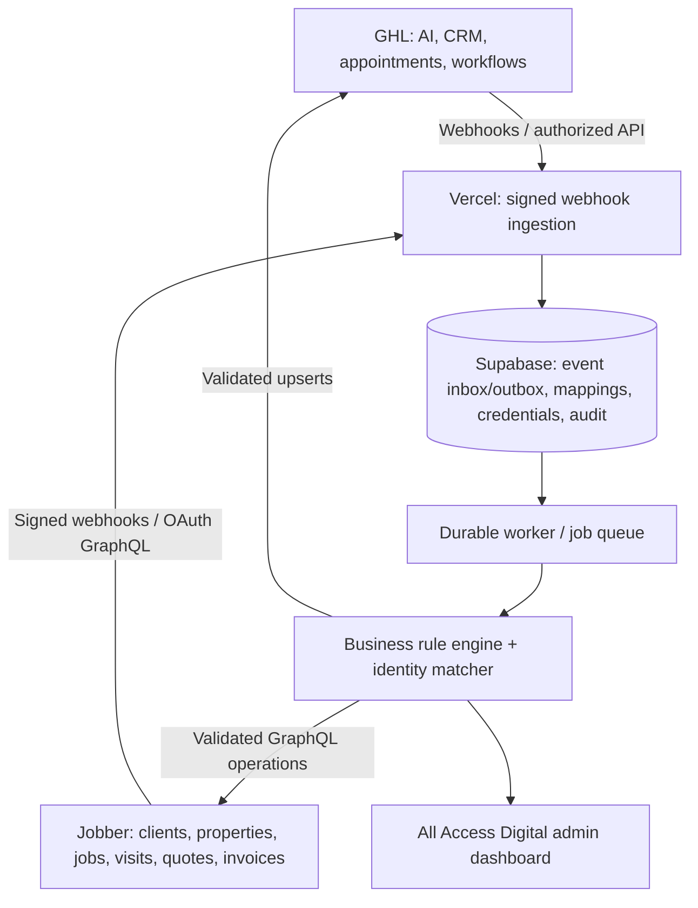

# Architecture and component boundaries

## System responsibilities

- Vercel: Next.js admin application, OAuth callback, securely verified inbound webhook endpoints, APIs for admin UI; avoid long-running work in webhook request.
- Supabase: dedicated project per client. Stores encrypted connection records, event log, work queue state, mappings, snapshots, action ledger, conflicts, backfill cursors. Row-level isolation when applicable, but never expose service credentials to browser.
- Worker: durable queue (e.g. Upstash QStash or approved equivalent), bounded retries, dead-letter queue, idempotency, rate limits. Choose exact queue after feasibility/cost review.
- Jobber adapter: OAuth token lifecycle, GraphQL pinned-version client, account identity, typed schema-derived operations, webhook signature check. Do not assume all mutations available.
- GHL adapter: version-aware REST SDK, Private Integration Token for single-location integration, locations/pipelines/stages/calendar discovery, inbound webhook validation.
- Domain engine: field ownership, customer match/linking, job/visit mapping, availability contract, workflow dispatch, reconciliation.

## Essential invariants

1. There is exactly one **canonical internal link** for a Jobber client ↔ GHL contact pair; do not merge uncertain identities.
2. Each Jobber job can map to a distinct GHL opportunity. A client can have many jobs and many GHL opportunities.
3. One GHL appointment can map to one Jobber visit; several visits may map to one Jobber job. Reschedule edits mapped visit rather than creating new job.
4. Jobber owns confirmed scheduling, customer master, property, operational job state, quote and invoice status.
5. Historical imports never send customer messages, create live invoice/estimates or trigger review requests.
6. Every mutation is linked to an inbound event, actor, approval state, and immutable audit entry.
7. API 200 with GraphQL `errors` / mutation `userErrors` is a failure; do not mark synced.
8. No environment silently points to another client's GHL location or Jobber account. On connect, verify account identity against allowlist.

## Why not only Zapier?

Bidirectional mapping, OAuth refresh rotation, bulk history, deduplication, resilient queueing, conflict resolution, job/visit linkage, and per-job review ledger require central state and traceability. Zapier may still call inbound APIs for specific workflows but should not own the core sync truth.

## Availability reality check

Jobber is authoritative, but an API endpoint to hold/reserve a time slot has **not** been proven for the authorized account. Cursor must audit actual Jobber GraphQL schema, service scheduling settings, technician availability and appointment booking capabilities. If safe slot confirmation isn't possible, implement `pending_jobber_confirmation` and alternative/manual handling; do not promise automatic real-time slot locking.
